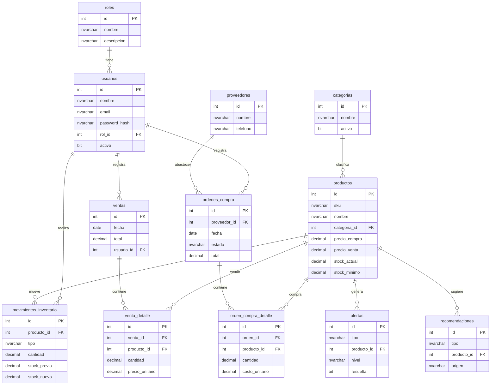

# Modelo Entidad-Relación · DistribuidoraDB

La base de datos está compuesta por **12 tablas** que cubren seguridad, catálogo,
inventario, ventas, compras, alertas y recomendaciones.

## Cómo generar el diagrama ER visual

Tiene tres formas de obtener el diagrama:

1. **dbdiagram.io (recomendado, más rápido):** abra <https://dbdiagram.io>, cree un
   diagrama nuevo y pegue el contenido de [`database/modelo_er.dbml`](../database/modelo_er.dbml).
   El diagrama se genera automáticamente y puede exportarlo como PNG/PDF.
2. **SQL Server Management Studio (SSMS):** conéctese a `DistribuidoraDB` →
   clic derecho en **Database Diagrams** → **New Database Diagram** → agregue todas
   las tablas. SSMS dibuja el ER a partir de las llaves foráneas reales.
3. **El diagrama Mermaid** incluido más abajo (se renderiza directamente en GitHub/Azure Repos).

## Diagrama (Mermaid)

## Descripción de entidades

| Tabla | Descripción | Relaciones clave |
|-------|-------------|------------------|
| **roles** | Catálogo de roles (Administrador, Propietario, Empleado). | 1—N usuarios |
| **usuarios** | Usuarios del sistema con credenciales y rol. | N—1 roles |
| **categorias** | Clasificación de productos. | 1—N productos |
| **productos** | Catálogo con precios y stock actual/mínimo. | N—1 categorias |
| **movimientos_inventario** | Libro mayor de entradas y salidas de stock. | N—1 productos, usuarios |
| **proveedores** | Directorio de proveedores. | 1—N ordenes_compra |
| **ordenes_compra** | Cabecera de órdenes de compra (estado PENDIENTE/RECIBIDA). | N—1 proveedores |
| **orden_compra_detalle** | Líneas de cada orden de compra. | N—1 ordenes_compra, productos |
| **ventas** | Cabecera de ventas con total. | N—1 usuarios |
| **venta_detalle** | Líneas de cada venta (base del análisis estadístico). | N—1 ventas, productos |
| **alertas** | Alertas de stock mínimo y reposición. | N—1 productos |
| **recomendaciones** | Recomendaciones estadísticas y de IA almacenadas. | N—1 productos |

## Reglas de negocio implementadas

- Cada **venta** genera movimientos de **SALIDA** y descuenta el stock dentro de una
  transacción (atomicidad garantizada).
- Cada **orden de compra recibida** genera movimientos de **ENTRADA** e incrementa el stock.
- Cuando el stock de un producto cae por debajo del mínimo, se crea automáticamente una
  **alerta de stock mínimo** (evitando duplicados no resueltos).
- Los subtotales de `venta_detalle` y `orden_compra_detalle` son **columnas calculadas
  persistidas** (`cantidad × precio`).
